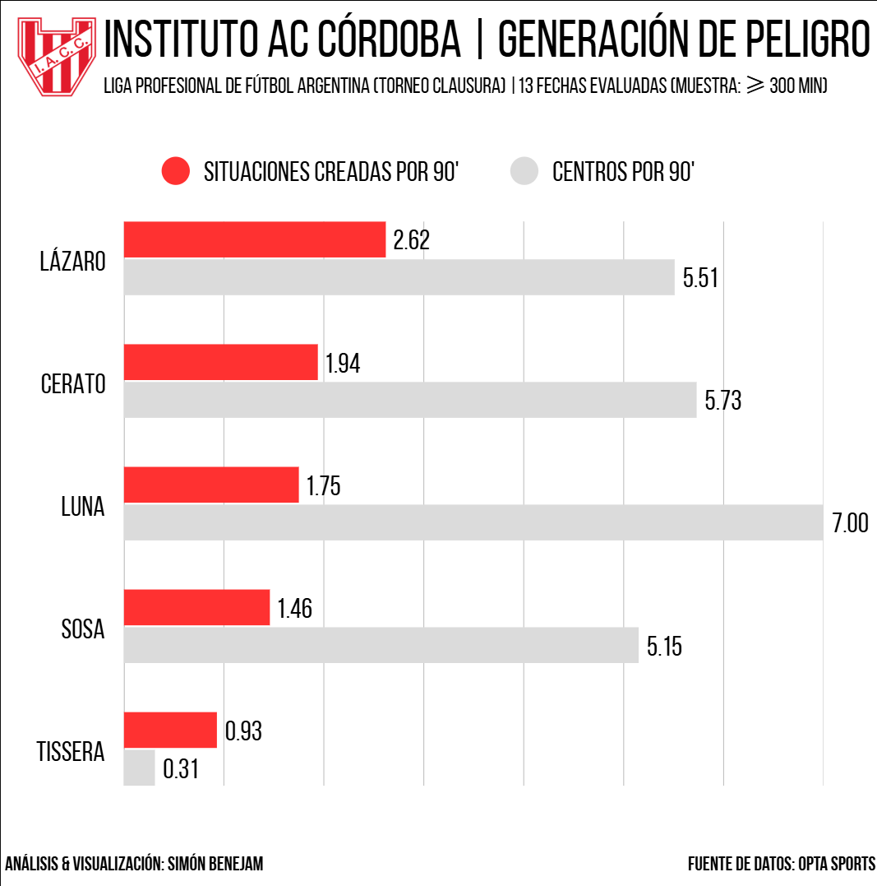
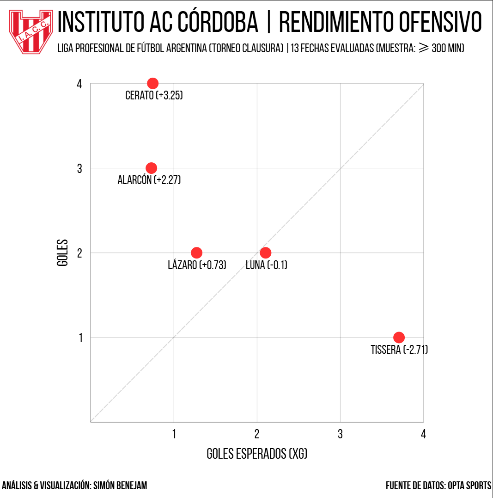

# ⚽ Instituto AC Córdoba - Análisis Táctico & Rendimiento Ofensivo
**Liga Profesional de Fútbol Argentino | Torneo Clausura**  
*Muestra analizada: Primeras 13 fechas (Filtro metodológico: minutos disputados ≥ 300)*  
**Autor:** Simón Benejam — *Data Science & Sports Analytics*

---

## 📖 1. Contexto Táctico & Planteo de la Hipótesis

A lo largo de las primeras 13 fechas del Torneo Clausura, el rendimiento de Instituto AC Córdoba presentaba una contradicción evidente para el ojo del observador: el equipo marchaba puntero de su zona, pero a su referencia de área le costaba horrores convertir goles de jugada abierta.

Al analizar el modelo colectivo y los patrones posicionales en fase de posesión, saltó a la vista una dinámica particular:
* **Amplitud y profundidad exterior:** La agresividad ofensiva no nacía de extremos puros, sino del adelantamiento masivo de los laterales.
* **Roles en ataque:** Giuliano Cerato (por derecha) y Diego Sosa (por izquierda) asumían una participación ofensiva primaria, posicionándose prácticamente como extremos bis, buscando la línea de fondo de forma sistemática y abasteciendo el área.
* **La paradoja del gol:** El equipo generaba volumen y llegadas constantes por las bandas, pero la pelota no terminaba en la red por obra del centrodelantero.

### La pregunta de investigación:
> ¿Era solo una sensación visual desde la tribuna o el modelo descansaba estructuralmente en las bandas? Y si el abastecimiento existía, ¿la sequía atacante se debía a falta de gestación o a un déficit crítico en la conversión individual?

---

## 🛠️ 2. Pipeline de Datos & Metodología en Python

Para contrastar la hipótesis con evidencia empírica, se recurrió a los registros de eventos de **Opta Sports**. El procesamiento se desarrolló íntegramente en Python utilizando **Pandas** bajo el siguiente criterio:

1. **Filtro de representatividad:** Se descartaron futbolistas con muestras estadísticas residuales, estableciendo un corte en **minutos jugados ≥ 300**.
2. **Normalización por 90 minutos (P90):** Dado que no todos los futbolistas disputaron la misma cantidad de minutos, cada métrica volumétrica se normalizó a P90 para contrastar rendimientos sobre una base equitativa:
   
   `Métrica P90 = (Total del evento / Minutos jugados) * 90`

3. **Métricas analizadas:**
   * **Shot-Creating Actions (SCA):** Las dos acciones ofensivas previas con balón (pases, regates, faltas recibidas) que derivan directamente en un remate.
   * **Centros P90:** Volumen de envíos directos desde los costados al área rival.
   * **Goles Esperados (xG):** Probabilidad estadística acumulada de que un disparo termine en gol según la calidad y posición de la ocasión.
   * **Diferencial de Efectividad (Delta xG):** Brecha entre goles reales anotados y goles esperados:  
     `Delta xG = Goles Reales - xG Esperados`

---

## 📊 3. Resultados & Hallazgos Estadísticos

### A. La Autopista por las Bandas: Generación de Peligro
El análisis de volumen ratificó la dependencia del juego exterior:



* **Jeremías Lázaro** comanda la gestación pura por carriles internos con **2.62 SCA P90** y **5.51 centros P90**.
* **Giuliano Cerato** representa la gran anomalía táctica: como lateral derecho, se ubicó como segundo máximo generador con **1.94 SCA P90** (explicando cerca del 18% del peligro total del equipo) y **5.73 centros P90**.
* **Diego Sosa** complementa la banda izquierda con **1.46 SCA P90** y **5.15 centros P90**.
* **Alex Luna** aporta el mayor volumen de envíos al área con **7.00 centros P90** y **1.75 SCA P90**.
* Entre estos cuatro intérpretes exteriores concentraron casi dos tercios de la producción ofensiva del plantel, demostrando que el circuito funcionaba y abastecía con frecuencia.

---

### B. La Paradoja de la Conversión: xG vs. Goles Reales
Al contrastar la generación con la efectividad de cara al arco, la anomalía del puntero quedó al descubierto:



* **Matías Tissera (Déficit de finalización):** El modelo táctico lo abasteció con continuidad. Acumuló **3.71 xG** (la cifra más alta del plantel por amplia diferencia), pero convirtió solo **1 gol**. Su saldo negativo de **-2.71 Delta xG** no se debió a desconexión del circuito, sino a un bache de puntería en la definición.
* **Giuliano Cerato (Sobre-rendimiento extraordinario):** El goleador del equipo en 13 fechas fue su lateral derecho, con **4 tantos**. Convirtió a partir de apenas **0.75 xG** acumulado y un 61.5% de puntería al arco, registrando un Delta xG descomunal de **+3.25** sobre la expectativa matemática.
* **Fernando Alarcón (Segundas jugadas y balón detenido):** El zaguero central aportó **3 goles** llegando desde atrás con un diferencial positivo de **+2.27 Delta xG**, destrabando partidos clave.

---

## 🧠 4. Diagnóstico Táctico & Desafíos para los Playoffs

El análisis arroja una conclusión categórica: **Instituto sostuvo la cima del torneo gracias a una sobre-eficacia extraordinaria de sus defensores que compensó la falta de gol de sus atacantes.**

Sin embargo, en el fútbol de alto rendimiento, los sobre-rendimientos de defensores con cuotas de gol atípicas tienden a normalizarse estadísticamente en el mediano plazo. Pero la alerta principal no es solo matemática, sino **biológica y estructural**:

1. **Desgaste físico extremo:** Exigirle a Cerato y Sosa que recorran la banda de área a área, tiren más de 5 centros por fecha, lleguen al remate y además replieguen 70 metros para no quedar descompensados en la transición rival implica una demanda física demoledora.
2. **Fatiga y riesgo de lesiones:** Con 13 fechas encima y duelos decisivos a matar o morir, sostener este esfuerzo sin rotación expone a los carrileros a una merma física y a un mayor riesgo de lesiones musculares.
3. **El desafío del cuerpo técnico:** De cara a las fechas finales y los playoffs, la prioridad táctica debe orientarse a calibrar la definición de sus delanteros de área para facturar lo que el equipo genera, dosificar el desgaste de las bandas y no depender exclusivamente del heroísmo goleador de la última línea.

---

## 📂 5. Estructura del Repositorio

```text
├── img/
│   ├── generación_de_peligro.png   # Gráfico de barras normalizado P90 (SCA vs Centros)
│   └── rendimiento_ofensivo.png    # Gráfico de dispersión (Goles vs xG)
├── notebooks/
│   └── analisis_instituto.ipynb    # Pipeline de Pandas con la limpieza y normalización
└── README.md                       # Informe técnico del proyecto
